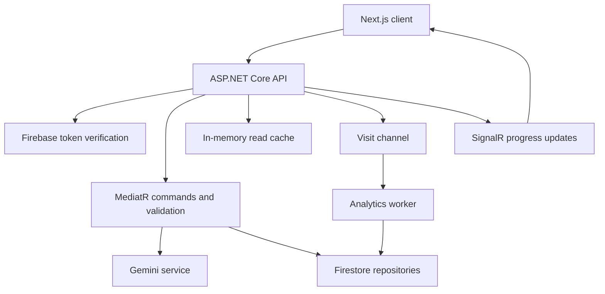

# Launchify · Backend API

**AI-assisted landing pages, with authenticated project management and asynchronous visit tracking.**

ASP.NET Core 8 · C# · Firestore · Firebase Auth · MediatR · FluentValidation · SignalR

[Frontend source](https://github.com/bora399/launchify-frontend) · [Demo URL](https://launchify-frontend-theta.vercel.app) · [Authentication notes](AUTHENTICATION.md)

## What it does

Launchify turns a product brief into a landing-page configuration. The API coordinates AI generation, stores pages, manages generation credits, accepts waitlist signups, and records visits. The companion Next.js client renders and edits the pages.

## Start your code review here

| Question | Implementation |
| --- | --- |
| Who can access a project? | [Firebase authentication handler](Presentation/Launchify.WebAPI/Authentication/FirebaseAuthenticationHandler.cs), [controller ownership checks](Presentation/Launchify.WebAPI/Controllers/LandingPagesController.cs) |
| What happens if AI generation fails? | [Credit reservation and compensating refund](Core/Launchify.Application/Features/LaunchifyPages/Commands/CreateLandingPage/CreateLandingPageCommandHandler.cs) |
| How are competing credit updates handled? | [Firestore user transactions](Infrastructure/Launchify.Persistence/Repositories/UserRepository.cs), [owned deletion and refund](Infrastructure/Launchify.Persistence/Repositories/LandingPageRepository.cs) |
| How are repeated reads served? | [Cache-aside reads, expiration and mutation invalidation](Presentation/Launchify.WebAPI/Controllers/LandingPagesController.cs) |
| How are visits processed? | [In-process channel](Infrastructure/Launchify.Infrastructure/Services/AnalyticsQueueService.cs), [background worker](Infrastructure/Launchify.Infrastructure/Services/AnalyticsWorker.cs) |
| What is tested? | [HTTP authorization](Launchify.Tests/Security/ApiAuthorizationTests.cs), [generation safety](Launchify.Tests/Application/CreateLandingPageSafetyTests.cs), [queries](Launchify.Tests/Application/LandingPageQueryTests.cs) |

## Architecture



The solution separates domain entities, application commands/interfaces, infrastructure services, persistence, and HTTP presentation. Commands use MediatR; several reads and updates are handled directly by controllers. The database is **Firestore**, not EF Core.

## Engineering decisions

- **Server-derived identity:** private endpoints use verified Firebase claims. A client-provided user ID does not grant access to another user's projects.
- **Credit reservation:** generation deducts a credit before the upstream AI request, then attempts compensation on failure. This is a multi-step workflow, not a transaction spanning the AI provider and database.
- **Cache-aside reads:** public pages and user lists are cached with expiration. Mutations invalidate the corresponding local cache keys; `X-Cache` exposes hit/miss behavior.
- **Background analytics:** visits enter a process-local channel. This reduces work in the request path, but does not provide durable delivery across restarts.
- **Progress delivery:** SignalR sends generation logs to the authenticated user.

## API overview

| Method | Route | Access |
| --- | --- | --- |
| POST | `/api/LandingPages/create` | Authenticated; generation rate limit |
| GET | `/api/LandingPages/user/{userId}` | Matching authenticated user |
| GET | `/api/LandingPages/{slug}` | Public |
| PUT / DELETE | `/api/LandingPages/{id}` | Project owner |
| POST | `/api/LandingPages/ai-assist` | Authenticated; generation rate limit |
| POST | `/api/Waitlist` | Public signup |
| GET | `/api/Waitlist/{pageId}` | Project owner |
| POST | `/api/Analytics/{pageId}/visit` | Public visit tracking |
| GET | `/api/LandingPages/ping` | Public |

Waitlist signup normalizes email and checks for an existing entry. The check and write are separate operations; this is not an atomic uniqueness guarantee.

## Run locally

Requirements: .NET 8 SDK, your own Firebase project with Firestore, Firebase service-account credentials, and a Gemini API key.

```bash
git clone https://github.com/bora399/launchify-backend.git
cd launchify-backend
dotnet restore Launchify.sln
```

Set configuration in the shell that runs the API. PowerShell example:

```powershell
$env:Firebase__ProjectId = "your-firebase-project-id"
$env:Gemini__ApiKey = "your-gemini-api-key"
$env:FIREBASE_JSON = Get-Content -Raw "C:\credentials\firebase-service-account.json"
dotnet run --project Presentation/Launchify.WebAPI/Launchify.WebAPI.csproj --launch-profile http
```

Use a credential file outside the repository. Do not commit credentials. The existing bootstrap also recognizes a local `firebase-key.json`; `FIREBASE_JSON` takes precedence.

The checked-in HTTP launch profile uses `http://localhost:5125`; Swagger is at `http://localhost:5125/swagger`. Set the frontend's `NEXT_PUBLIC_API_URL` to this base URL. Firebase project IDs must match on both sides. CORS currently allows `http://localhost:3000` and the configured Vercel origin.

## Tests

```bash
dotnet test Launchify.Tests/Launchify.Tests.csproj
```

The repository includes xUnit tests for authorization, generation failure handling, queries, and analytics. HTTP authorization tests replace external services with test doubles. These do not establish live Firebase/Firestore correctness or measured production performance.

## Current boundaries and next steps

- Reserve unique slugs atomically and make page creation idempotent.
- Make analytics batching, retry and shutdown behavior reliable; use durable delivery when needed.
- Make waitlist uniqueness atomic and validate the target page.
- Scope forwarded-header trust to the deployment's actual proxies.
- Add Firestore integration tests and reproducible load measurements before making latency claims.

See [AUTHENTICATION.md](AUTHENTICATION.md) for the newer authentication work. [PROJECT_REVIEW.md](PROJECT_REVIEW.md) is a historical review; some findings have since been addressed.
