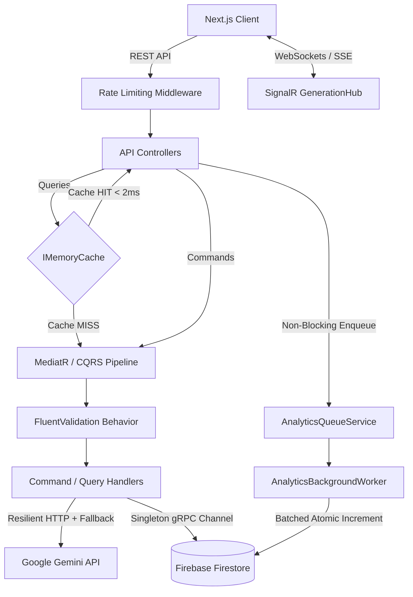

# Launchify — Backend API (.NET Core)


Backend Web API for **Launchify**, an AI-powered SaaS platform that generates conversion-focused landing pages and manages early-access waitlists. Built with **C# / ASP.NET Core** following **Clean Architecture** and **CQRS** principles.

🔗 **Live Frontend:** [launchify-frontend-theta.vercel.app](https://launchify-frontend-theta.vercel.app)  
🔗 **Frontend Repository:** [github.com/bora399/launchify-frontend](https://github.com/bora399/launchify-frontend)

---

## 🏗️ System Architecture & Request Flow



---

## ⚙️ Key Engineering Highlights

Rather than a basic CRUD API, this service implements production-grade backend patterns to handle latency, third-party API unreliability, and database cost optimization:

### 1. Clean Architecture & CQRS (`MediatR` + `FluentValidation`)
* **Strict Separation of Concerns:** Divided into `Domain`, `Application`, `Infrastructure`, `Persistence`, and `WebAPI` layers.
* **Pipeline Validation:** Request payloads are validated automatically via `ValidationBehavior<TRequest, TResponse>` before reaching business logic, handled centrally by `GlobalExceptionHandler`.

### 2. Cache-Aside Pattern & Deterministic Cache Invalidation (`IMemoryCache`)
* **Read Optimization:** Public landing pages (`GET /api/LandingPages/{slug}`) and user project lists (`GET /api/LandingPages/user/{userId}`) are read-heavy. Responses are cached in memory with sliding and absolute expiration policies, reducing response times from ~250ms to **<2ms**.
* **Observability:** Responses expose `X-Cache: HIT` or `X-Cache: MISS` HTTP headers.
* **Explicit Invalidation:** Any state mutation (`POST`, `PUT`, `DELETE`) triggers deterministic cache eviction for both the specific slug and the owner's project list to prevent stale reads.

### 3. Asynchronous Background Processing (`IHostedService`)
* **Non-Blocking Analytics:** Page view increments are decoupled from the HTTP request thread. Incoming traffic metrics are pushed to a singleton `AnalyticsQueueService` and processed asynchronously in the background by `AnalyticsBackgroundWorker` using Firestore atomic increments (`FieldValue.Increment`).

### 4. Resilient LLM Integration (`GeminiAiService`)
* **Multi-Model Fallback & Retry Policy:** Implements a fallback chain across multiple Gemini models with exponential backoff on `429 Too Many Requests` and `503 Service Unavailable` responses.
* **Credit Protection & Rollback:** User generation credits are only deducted upon verified persistence, ensuring failed upstream AI calls never penalize the user.
* **Output Sanitization:** Enforces `application/json` MIME types combined with deterministic bracket extraction to prevent malformed LLM markdown responses from breaking deserialization.

### 5. Real-Time Generation Telemetry (`SignalR`)
* Streams step-by-step generation stages (`[Step 1/4]` through `[Step 4/4]`) directly to the client's `ConnectionId` over `GenerationHub`, providing live feedback during long-running AI tasks.

### 6. Security, Rate Limiting & Bot Mitigation
* **IP & User Partitioned Rate Limiting:** Built-in `.NET RateLimiter` (`FixedWindowLimiter`) protects AI generation endpoints from abuse using `X-User-Id` and `X-Forwarded-For` headers behind reverse proxies.
* **Silent Honeypot Trap:** Waitlist endpoints inspect a hidden honeypot field; automated spam bots receive a silent `200 OK` without triggering database writes.
* **Idempotent Lead Capture:** Emails are normalized and checked against composite (`PageId` + `Email`) existence queries, returning `409 Conflict` on duplicate submissions.
* **Singleton gRPC Reuse:** `FirestoreDb` is registered as a singleton instance to reuse the underlying gRPC channel and avoid repeated SSL/OAuth handshakes.

---

## 📡 Core API Endpoints

| Method | Endpoint | Description | Auth / Policy |
| :--- | :--- | :--- | :--- |
| `POST` | `/api/LandingPages/create` | Generates a new AI landing page & streams logs via SignalR | `AiCreationLimit` |
| `GET` | `/api/LandingPages/{slug}` | Retrieves public landing page config (`X-Cache: HIT/MISS`) | `AllowAnonymous` |
| `GET` | `/api/LandingPages/user/{userId}` | Lists all projects belonging to a user (Cached) | User Scoped |
| `PUT` | `/api/LandingPages/{id}` | Updates page content/theme & invalidates cache | User Scoped |
| `DELETE` | `/api/LandingPages/{id}` | Deletes project, refunds 1 user credit & invalidates cache | User Scoped |
| `POST` | `/api/LandingPages/ai-assist` | Live AI copywriting & tone transformation (`punchy`, `corporate`, `minimal`, `redesign`) | `AllowAnonymous` |
| `POST` | `/api/Waitlist` | Captures lead with Honeypot bot filtering & `409` duplicate check | `AllowAnonymous` |
| `GET` | `/api/Waitlist/{pageId}` | Returns collected waitlist leads ordered by timestamp | User Scoped |
| `POST` | `/api/Analytics/track` | Enqueues non-blocking page view events to background worker | `AllowAnonymous` |
| `GET` | `/api/LandingPages/ping` | Lightweight health-check endpoint for container pre-warming | `AllowAnonymous` |

---

## 🚀 Local Development Setup

### Prerequisites
* .NET 8.0 SDK
* Firebase Project with Firestore enabled (`firebase-key.json`)
* Google Gemini API Key

### 1. Clone the repository
```bash
git clone [https://github.com/bora399/launchify-backend.git](https://github.com/bora399/launchify-backend.git)
cd launchify-backend
```

### 2. Configure Environment Variables
Place your `firebase-key.json` in the API root directory (or set the `FIREBASE_JSON` environment variable) and configure `appsettings.Development.json`:

```json
{
  "Firebase": {
    "ProjectId": "your-firebase-project-id"
  },
  "Gemini": {
    "ApiKey": "your-gemini-api-key"
  }
}
```

### 3. Run the API
```bash
dotnet restore
dotnet run --project Launchify.WebAPI
```
Swagger UI will be available at `http://localhost:5000/swagger`.
